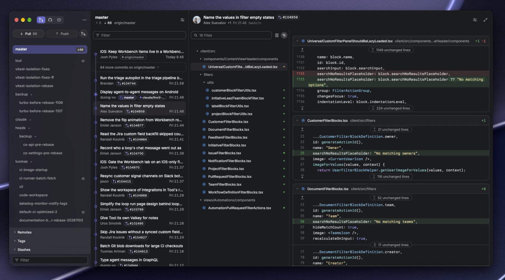

# gitflow

A fast, readable desktop Git client for macOS. Built with Tauri 2, React, TypeScript and Tailwind.

**Status:** alpha. gitflow works on real local repositories: history, branches, diffs, staging, commits, branch switching and fetch/pull/push.

### GitHub and other remotes

gitflow runs your own `git`, so it uses the authentication Git already has: the `gh` credential helper (`gh auth setup-git`), the macOS keychain, or your SSH agent. gitflow stores no tokens. Git never prompts in the app (`GIT_TERMINAL_PROMPT=0`): if your credentials are missing, the operation fails with Git's message.

### Safety

- Pull is `--ff-only`: it never creates an unexpected merge.
- Push never uses `--force`. A branch without upstream is published to `origin`.
- Switching branches uses `git switch`, which refuses to overwrite uncommitted changes.
- gitflow has no reset, clean or discard actions.

### Known limitations

- No stash/merge/rebase/cherry-pick actions and no conflict resolution: resolve conflicts in your editor, then stage the files here.
- The commit filter only searches commits already loaded (200 per page; more load as you scroll).
- "N unchanged lines" can't be expanded yet. Diffs have no syntax highlighting and stop rendering after 3,000 lines.
- Paths that aren't valid UTF-8 are displayed lossily and can't be staged.



## Requirements

- Xcode Command Line Tools (`xcode-select --install`)
- Node.js LTS and pnpm
- Rust stable via [rustup](https://rustup.rs). You need it for `pnpm tauri dev`, not for the frontend scripts.
- Git CLI

## Scripts

| Command          | What it does                                                             |
| ---------------- | ------------------------------------------------------------------------ |
| `pnpm tauri dev` | Run the desktop app                                                      |
| `pnpm dev`       | Run the frontend alone in a browser (port 1420)                          |
| `pnpm test`      | Vitest unit and UI tests                                                 |
| `cargo test`     | Rust parser and integration tests (run in `src-tauri/`, uses temp repos) |
| `pnpm lint`      | ESLint (strict typescript-eslint and React hooks)                        |
| `pnpm typecheck` | `tsc --noEmit`                                                           |
| `pnpm format`    | Prettier                                                                 |
| `pnpm build`     | Type-check and build the frontend into `dist/`                           |

## Layout

```
src/
  app/               App root, providers, UI tests (backend mocked)
  components/        layout (4-column shell, notices), ui (shadcn/ui)
  features/          branches · history · changed-files · diff · working-tree · repositories · operations
  lib/               tauri-git.ts (typed client), git-queries.ts (TanStack Query), helpers
  stores/            Zustand: workspace selection, notices
  types/git.ts       Mirror of src-tauri/src/git/model.rs
src-tauri/src/
  commands.rs        Tauri command surface
  git/runner.rs      The only process spawner: `git` + argument vector, timeouts, output cap
  git/validate.rs    Validation of every UI input
  git/parser.rs      Parsers for NUL-separated git output
  git/read.rs        Read-only queries
  git/write.rs       Write operations (non-destructive only)
```

## Git engine rules

The frontend only calls typed Tauri commands. Rust runs `git` with an argument array: no shell, no `sh -c`, and no string concatenation of UI input. It never runs `reset --hard`, `clean -fd`, `push --force` or a checkout that could overwrite changes without explicit confirmation.
